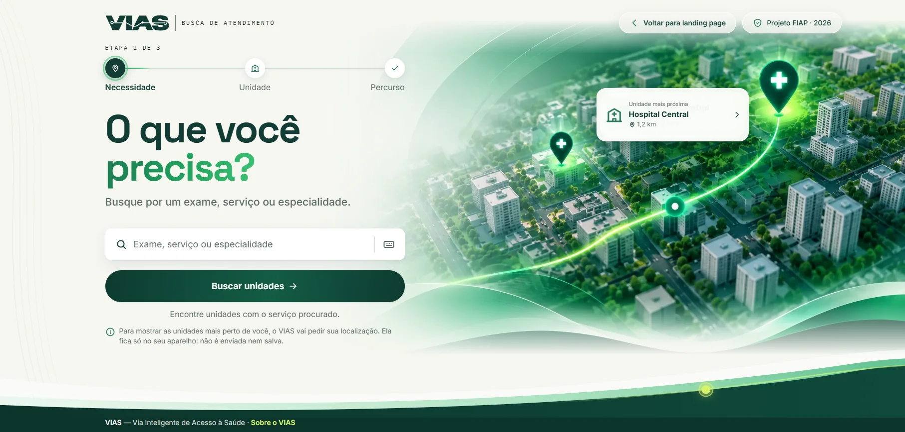
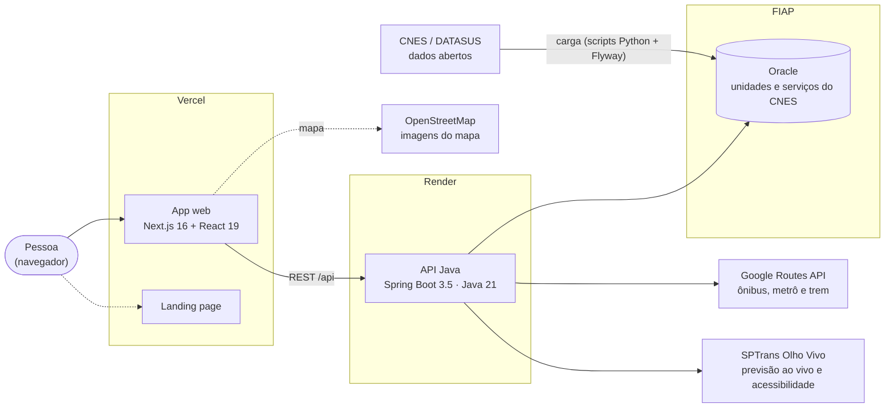

<div align="center">

# VIAS — Via Inteligente de Acesso à Saúde

**Encontre a unidade de saúde certa, veja quais estão mais perto e saiba que horas sair de casa para chegar a tempo, de transporte público.**

Projeto da **Global Solution FIAP 2026 · CitizenTech**

[](https://vias-jet.vercel.app)
[](https://vias-viainteligentedeacessoasaude.vercel.app)
[](https://vias-dfwu.onrender.com/swagger-ui.html)


<br>



<sub>Tela inicial da demonstração publicada em <a href="https://vias-jet.vercel.app">vias-jet.vercel.app</a>.</sub>

</div>

---

## Links do projeto

| | Endereço | Onde está hospedado |
|---|---|---|
| 🩺 **Demonstração (app web)** | <https://vias-jet.vercel.app> | Vercel |
| 🌐 **Landing page institucional** | <https://vias-viainteligentedeacessoasaude.vercel.app> | Vercel (projeto separado) |
| ⚙️ **API Java** | <https://vias-dfwu.onrender.com> | Render (Docker, plano gratuito) |
| 📘 **Documentação da API (Swagger)** | <https://vias-dfwu.onrender.com/swagger-ui.html> | Render |
| 💚 **Health check da API** | <https://vias-dfwu.onrender.com/actuator/health> | Render |
| 🗄️ **Banco de dados** | Oracle da FIAP (`oracle.fiap.com.br`) | Infraestrutura da FIAP |

> **Primeiro acesso:** a API usa o plano gratuito do Render, que "dorme" sem uso. A primeira consulta pode levar até 1 minuto, e a tela avisa enquanto espera. Depois disso, as respostas são rápidas.

---

## O problema

Quem precisa de um exame ou de uma especialidade pelo SUS muitas vezes não sabe **qual unidade oferece o serviço**, **qual delas fica mais perto** nem **como chegar a tempo de transporte público**. As informações existem, mas estão espalhadas: o cadastro oficial de unidades (CNES), os horários de ônibus, metrô e trem e a previsão ao vivo dos ônibus.

## A solução

O VIAS junta essas fontes num fluxo de três passos, pensado para o celular:

| Etapa | O que a pessoa faz | O que o VIAS responde |
|---|---|---|
| **1. Necessidade** | Digita o exame, serviço ou especialidade ("mamografia", "dermatologia") | Sugestões do catálogo real, agrupadas em exames, especialidades e atendimento |
| **2. Unidade** | Permite usar a localização do aparelho | As unidades com aquele serviço, da mais próxima para a mais distante, com endereço, telefone, horário, atendimento SUS e acessibilidade |
| **3. Percurso** | Informa a hora do atendimento (ou "sair agora") | **"Faltam X min para sair"**, a chegada prevista, as opções de ônibus, metrô e trem, o mapa e o passo a passo, com os ônibus **acessíveis** previstos ao vivo pela SPTrans |

---

## Arquitetura



- O navegador **só conversa com a API Java**. Nenhuma chave de API fica no front-end: as chaves do Google e da SPTrans ficam nas variáveis de ambiente do Render.
- A ordenação por distância é feita **no próprio aparelho**. A localização só sai do aparelho para calcular o percurso, vai no corpo da requisição e **não é salva**.

---

## Tecnologias

| Parte | Tecnologias |
|---|---|
| **App web** (`apps/web`) | Next.js 16 (App Router), React 19, JavaScript, Tailwind CSS 4, Leaflet + React Leaflet, Jest + React Testing Library, ESLint |
| **API** (`services/api`) | Java 21, Spring Boot 3.5, Spring Data JPA, Flyway, Bean Validation, springdoc-openapi (Swagger), JUnit + Mockito, Docker (deploy) |
| **Banco** | Oracle da FIAP, com migrações versionadas pelo Flyway (V1 a V6) |
| **Integrações** | Google Routes API (transporte público), SPTrans Olho Vivo (previsão ao vivo), OpenStreetMap (mapa) |
| **Dados** | CNES (Ministério da Saúde) via API de Dados Abertos e arquivos do DATASUS; scripts Python de carga |
| **Hospedagem** | Vercel (app web e landing), Render (API), Oracle da FIAP (banco) |

---

## Dados e fontes

| Fonte | Para quê | Observação |
|---|---|---|
| **CNES – API de Dados Abertos (DEMAS)** | Unidades de saúde de São Paulo: nome, tipo, endereço, telefone, horário, atendimento SUS, coordenadas | 1.092 unidades ativas, carregadas pelo Flyway |
| **CNES – arquivos do DATASUS** | Exames, serviços especializados e especialidades de cada unidade | 83 itens no catálogo de busca |
| **Google Routes API** | Opções de ônibus, metrô e trem, horários e o desenho do caminho | Inclui uma consulta só de metrô e trem |
| **SPTrans Olho Vivo** | Próximos ônibus no ponto de embarque e quais são acessíveis | Só ônibus municipais da SPTrans |
| **OpenStreetMap** | Imagens do mapa do percurso | — |

**Regra do projeto:** dado ausente nunca vira resposta negativa. Quando a fonte não informa algo, a tela mostra **"Não informado pela fonte"**, e não "não possui". Nenhum dado pessoal de cidadãos é armazenado.

---

## Estrutura do repositório

| Pasta | O que é | Responsável | Situação |
|---|---|---|---|
| [`apps/web`](apps/web) | App web do cidadão (Next.js) | Victor | ✅ Publicado na Vercel |
| [`services/api`](services/api) | API principal (Java + Spring Boot) e migrações Flyway | Raphael | ✅ Publicada no Render |
| [`database`](database) | Modelo de dados (DER e dicionário) | Raphael | ✅ Diagramas em [`services/api/docs/diagramas`](services/api/docs/diagramas) |
| [`data/etl`](data/etl) | Carga de dados abertos em Python (CNES, acessibilidade) | Nicolas | ✅ Com testes (pytest) |
| [`services/otp`](services/otp) | Scripts do OpenTripPlanner (motor de rotas próprio) | Nicolas | Scripts prontos; o percurso publicado usa o Google Routes |
| [`services/ia`](services/ia) | Serviço de IA (Python + FastAPI) | Felipe | Planejado, fora desta entrega |
| [`apps/painel-gestor`](apps/painel-gestor) | Painel do gestor (React + Vite) | Felipe | Planejado, fora desta entrega |
| [`apps/mobile`](apps/mobile) | App nativo (Expo) | — | Planejado; o app web já funciona no celular |
| [`scripts`](scripts) | Preparação de servidor próprio (Oracle Cloud + Caddy) | Nicolas | Rascunho; o deploy atual usa Vercel e Render |
| [`docs`](docs) | Documentação geral e imagens deste README | Felipe | — |

---

## Como rodar localmente

### App web (`apps/web`)

Requisitos: Node.js 20.9 ou mais recente.

```bash
cd apps/web
npm install
cp .env.example .env.local      # PowerShell: Copy-Item .env.example .env.local
npm run dev                     # http://localhost:3000
```

| Comando | O que faz |
|---|---|
| `npm run dev` | Servidor de desenvolvimento |
| `npm run build` e `npm run start` | Build e servidor de produção |
| `npm test` | Testes (Jest + React Testing Library) |
| `npm run lint` | ESLint |

| Variável | Para quê | Exemplo |
|---|---|---|
| `NEXT_PUBLIC_API_URL` | Endereço da API, com o prefixo `/api` | `https://vias-dfwu.onrender.com/api` ou `http://localhost:8080/api` |

### API Java (`services/api`)

Requisitos: JDK 21 e Maven (ou o IntelliJ). Os detalhes estão no [README da API](services/api/README.md).

```bash
cd services/api
mvn spring-boot:run             # http://localhost:8080/swagger-ui.html
mvn test
```

| Variável | Para quê |
|---|---|
| `DB_USER`, `DB_PASS` | Usuário e senha do Oracle da FIAP (obrigatórias) |
| `CORS_ORIGENS` | Endereços do front liberados, separados por vírgula (ex.: `https://vias-jet.vercel.app,http://localhost:3000`) |
| `GOOGLE_ROUTES_CHAVE` | Chave do Google Cloud com a Routes API ativada (sem ela, o percurso responde 503) |
| `OLHOVIVO_TOKEN` | Token da SPTrans (sem ele, o percurso sai sem previsão ao vivo) |

> Nenhum segredo vai para o Git. O `.env` e o `.env.local` estão no `.gitignore`.

---

## Deploy

| Parte | Como é publicada |
|---|---|
| **App web** | Vercel, a partir de `apps/web` (`npx vercel@latest --prod`). Domínio fixo: `vias-jet.vercel.app` |
| **API** | Render, pelo [`render.yaml`](render.yaml) na raiz (Docker, `rootDir: services/api`), com as variáveis da tabela acima |
| **Banco** | Oracle da FIAP; o Flyway cria as tabelas e carrega os dados na primeira subida da API |

---

## Qualidade

- **App web:** 142 testes automatizados (Jest + React Testing Library), ESLint sem avisos e build de produção sem erros.
- **API:** testes com JUnit e Mockito (`mvn test`), incluindo o cálculo do percurso.
- **Acessibilidade:** navegação por teclado, foco visível, textos para leitor de tela e animações desligadas para quem pede menos movimento no aparelho.

---

## Documentação

- [Contrato da API usado pelo front-end](apps/web/docs/api.md)
- [README da API Java](services/api/README.md), com endpoints, camadas e variáveis
- [Diagramas: DER e classes](services/api/docs/diagramas)
- [ETL e carga de dados](data/etl/README.md)

---

## Equipe

| Integrante | RM | Frente |
|---|---|---|
| Felipe de Andrade Godoi | 566209 | Algoritmo Python (rotas) |
| Nicolas Marinho dos Santos | 563185 | Banco Oracle e dados |
| Raphael Naome Taketa | 562321 | Back-end Java |
| Victor Ribeiro Guimarães Lira | 566213 | Front-end Next.js |

---

<div align="center">
<sub>Projeto acadêmico da FIAP Global Solution 2026. O VIAS não substitui a orientação de um profissional de saúde.</sub>
</div>
