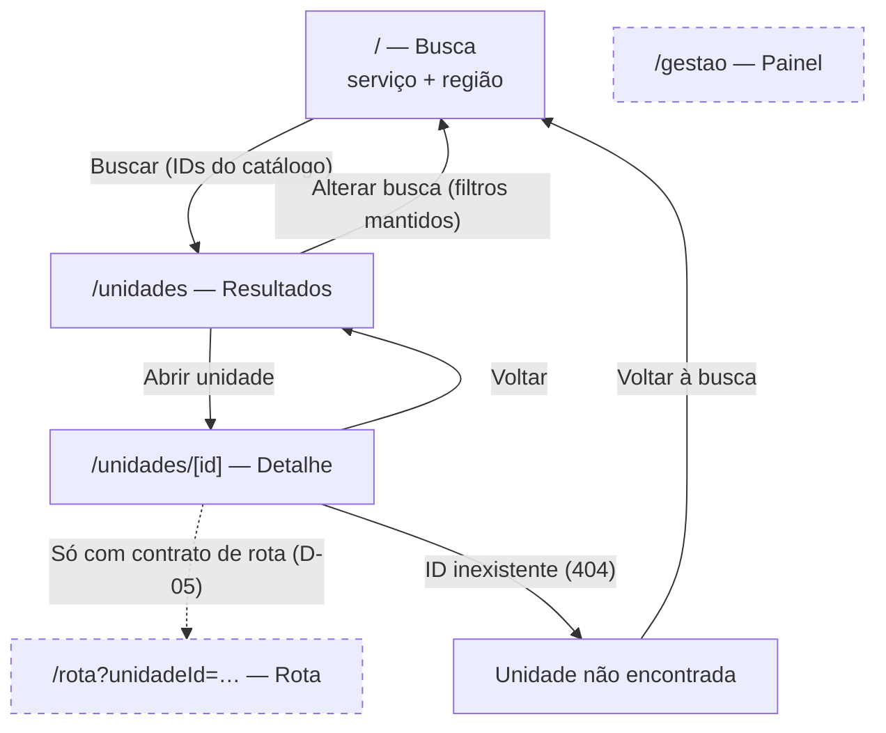

# Sitemap e fluxo de navegação (FE-03)

Responsável: Victor. Atualizado em 14/11/2026. **Status: proposta, aguardando aprovação do grupo.**

Base: documento de contexto do Victor (§5 e §6) e Alinhamento Técnico do MVP (§2 e §7). Os endpoints aparecem como **propostos**: nenhum está confirmado como disponível (D-04).

## Escopo do P0

O P0 é o fluxo **busca → resultados → detalhe**, mais as páginas de erro. Rota e painel gestor ficam como módulos condicionais: as rotas existem no plano, mas **não aparecem na navegação** enquanto não houver contrato aprovado (D-05 e D-07).

## Mapa de páginas

| Rota | Fase | Público | Objetivo | Fonte de dados (proposta) | Bloqueio |
|---|---|---|---|---|---|
| `/` | P0 | Cidadão | Busca: escolher o serviço ou necessidade e a região | `GET /api/servicos`, `GET /api/regioes` | D-04 |
| `/unidades` | P0 | Cidadão | Unidades com o serviço, **mais próximas primeiro** (localização do aparelho, D-18) | `GET /api/unidades?servicoId=…` (todas as páginas) | — |
| `/unidades/[id]` | P0 | Cidadão | Detalhe do que a API sabe sobre a unidade | `GET /api/unidades/{id}` | D-02, D-03, D-04 |
| `not-found` | P0 | Todos | Rota inexistente ou unidade não encontrada (404) | — | — |
| `error` | P0 | Todos | Falha inesperada, com opção de tentar de novo | — | — |
| `/rota?unidadeId=…` | P1, condicional | Cidadão | Pedir e ver o percurso até a unidade | Endpoint Java ainda não definido | D-05 |
| `/gestao` | P1, condicional | Gestor | Contagens agregadas por região e serviço | `GET /api/gestao/resumo` | D-07, indicadores |

**Proposta:** a busca fica na própria página inicial (`/`), e não em `/buscar`. Isso economiza um clique, e o documento de contexto permite essa escolha (§5). Se o grupo preferir `/buscar`, é só um redirecionamento.

## Fluxo principal

Linhas tracejadas indicam módulos condicionais: eles ficam fora da navegação até o contrato ser aprovado.

## Regras de navegação

1. **Serviço na URL, localização não.** A busca envia o ID real do serviço (`servicoId`) na query string; voltar e recarregar mantêm a busca. O local da pessoa vem da localização do aparelho (D-18), sem escolha manual de região, e **nunca vai para a URL**.
2. **Sem filtros extras.** Bairro e acessibilidade existem na API, mas não estão na tela; o filtro SUS/plano não entra (D-12). A ordem por proximidade é a resposta à pergunta “onde posso ser atendido?”.
3. **Nada sensível na URL.** Nenhuma localização do cidadão, sintoma ou texto pessoal vai para a URL, para o log ou para o armazenamento.
4. **Dados do servidor, não do navegador.** O detalhe e a rota buscam a unidade pelo `id`, nunca reaproveitam dados copiados da lista.
5. **Texto livre não vira diagnóstico.** O campo de busca filtra o catálogo retornado pela API; não interpreta sintomas.
6. **Navegação mínima.** Seguindo as [referências de UI](referencias-ui.md), o cabeçalho tem “[Voltar] VIAS │ RÓTULO DA TELA” e cada tela mostra o indicador de etapas (Necessidade → Unidade → Percurso). O logo leva a `/`; “Sobre o VIAS” fica no rodapé. “Rota” e “Gestão” só entram quando o módulo estiver liberado.

## Estados de cada página

Os estados seguem o documento de contexto §8.2 e §11. **Erro nunca vira lista vazia**, e dado ausente nunca vira “não possui”.

| Página | Carregando | Erro / indisponível | Vazio | Dado ausente |
|---|---|---|---|---|
| `/` | Skeleton nos seletores de serviço e região | “Não foi possível carregar o catálogo agora”, com botão de tentar de novo | “Nenhum serviço cadastrado ainda” | — |
| `/unidades` | Skeleton dos cards | Mensagem neutra com tentar de novo; 400 explica qual filtro corrigir | “Nenhuma unidade encontrada para estes filtros”, com opção de limpar filtros | Campo mostrado como “Não informado pela fonte” |
| `/unidades/[id]` | Skeleton do detalhe | Mensagem neutra com tentar de novo | — | Acessibilidade `NAO_INFORMADO` / `NAO_VERIFICADO` aparece por extenso; horário nulo não vira “aberto” nem “fechado”; sem coordenadas, só o endereço em texto |
| `not-found` | — | — | — | — |

## Telas para os protótipos (R1 e R2 da conformidade)

As três telas do P0 servem de base para os protótipos pedidos no PDF de DDD-Java e no PDF de Agile ([conformidade.md](conformidade.md)):

1. **Busca** (`/`): escolha do serviço e da região, em linguagem simples e com letra legível.
2. **Resultados** (`/unidades`): cards com nome, tipo, bairro e serviços, e os filtros ativos à vista.
3. **Detalhe** (`/unidades/[id]`): endereço, serviços, acessibilidade por estado, fonte e data.

## Aprovação

- [ ] Grupo aprova `/` como tela de busca (sem `/buscar`).
- [x] Raphael confirmou os query params (16/11). A tela usa só `servicoId`.
- [ ] Grupo concorda que rota e painel ficam fora da navegação até os contratos D-05 e D-07.
